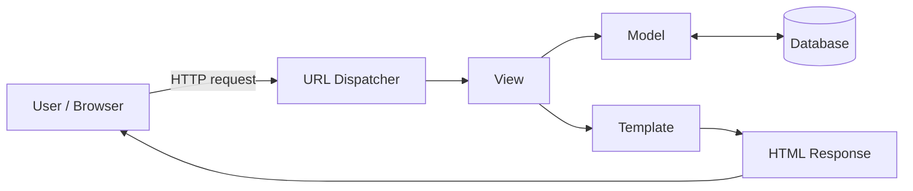
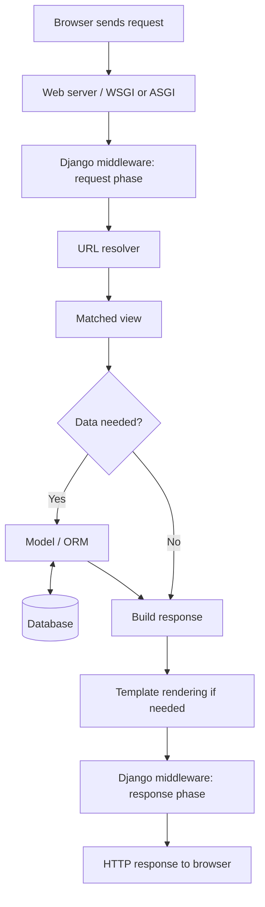
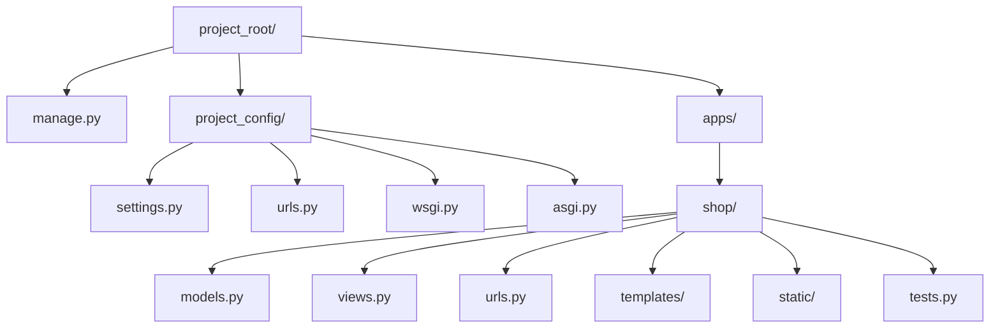

# Django Framework Architecture — Mermaid Document

**Purpose:** Corporate training reference for Django's architecture and request flow.

> Compatibility note: The diagrams use conservative Mermaid `flowchart LR` and `flowchart TD` syntax. They have been reviewed for balanced subgraphs, unique node IDs per diagram, and valid edge references. This is a static source review, not proof of rendering in a specific Mermaid host.

## Diagram 1 — Django MVT architecture

**Reading guide:** The URL dispatcher routes the request to a view. The view coordinates business logic, uses models for data access, and may render a template to produce the response. In Django, the framework's “controller-like” request handling is largely provided by the URL dispatcher and framework itself; the view is not the same as a traditional MVC controller in every framework.

## Diagram 2 — HTTP request lifecycle

**Reading guide:** Middleware can process requests before the view and responses after it. A view may query the ORM and database, render a template, or return another response type such as JSON.

## Diagram 3 — Django project structure

**Reading guide:** A Django *project* contains configuration for the whole site. A Django *application* groups a feature area and its code. The exact folder layout varies by team and project; `apps/` is a common organizational choice, not a Django requirement.

## Validation checklist

- [x] Three diagrams are included in one Markdown document.
- [x] Each diagram uses a recognized Mermaid flowchart declaration.
- [x] Node IDs are unique within each diagram.
- [x] Every edge refers to a node declared in that diagram.
- [x] No raw HTML, scripts, external resources, or styling directives are used.
- [ ] Render in the target editor/host to confirm host-specific Mermaid compatibility.

## Web Development Fundamentals

- Client–Server architecture
- HTTP/HTTPS
- Request & Response
- HTTP methods: GET, POST, PUT, PATCH, DELETE
- Status codes
- Headers, cookies and sessions
- URL, domain, hosting
- REST architecture basics
- MVC vs MVT

## Django Introduction

- What is Django?
- Django architecture
- Django features
- Django vs Flask/FastAPI
- Django project structure
- Django applications
- Django development workflow
- Django versions and LTS concepts

## Environment Setup

- Python installation
- Virtual environments
- pip
- Django installation
- Creating a project
- Creating an application
- Django development server
- settings.py
- urls.py
- manage.py

| Phase | Topic | Hours |
|---|---|---:|
| 1 | Web + Django Fundamentals | 6 |
| 2 | URLs, Views & Templates | 8 |
| 3 | Models & ORM | 10 |
| 4 | Admin & Forms | 6 |
| 5 | Authentication & Authorization | 6 |
| 6 | Advanced Django | 8 |
| 7 | Django REST Framework | 12 |
| 8 | Performance & Caching | 5 |
| 9 | Celery & Redis | 4 |
| 10 | Security | 4 |
| 11 | Testing | 4 |
| 12 | Deployment | 5 |
| 13 | Architecture & Capstone | 8 |
| **Total** | | **86 hrs** |
