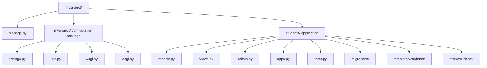
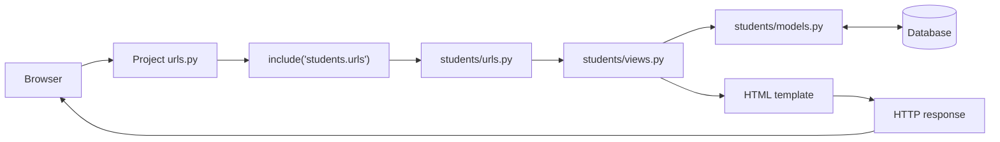
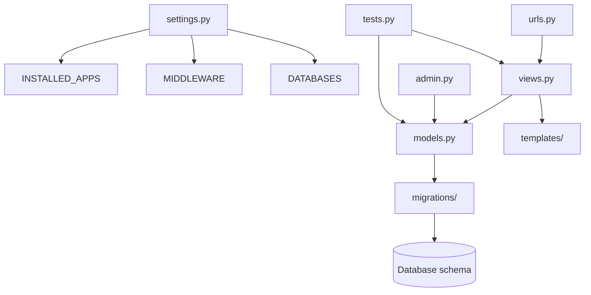

| File | Purpose |
|---|---|
| `admin.py` | Django admin configuration |
| `apps.py` | Application configuration |
| `models.py` | Database models |
| `views.py` | Business/request handling |
| `tests.py` | Application tests |
| `migrations/` | Database migration files |

# Django Project Structure — Mermaid Document

## Diagram 1 — Directory structure

## Diagram 2 — URL routing and request flow

Note: `students/urls.py`, templates, and static directories are commonly added by developers; `startapp` does not create all of them automatically.

## Diagram 3 — Responsibilities and dependencies

## Key file reference

| File or directory | Purpose |
|---|---|
| `manage.py` | Runs Django management commands. |
| `settings.py` | Configures apps, middleware, database, templates, static files, and security. |
| `urls.py` | Maps URL patterns to views and can include app-level URL configurations. |
| `asgi.py` / `wsgi.py` | Deployment entry points for ASGI- and WSGI-compatible servers. |
| `models.py` | Defines data models and database mapping. |
| `views.py` | Handles requests and returns responses. |
| `admin.py` | Registers models for Django admin. |
| `apps.py` | Defines application configuration. |
| `tests.py` | Contains automated tests. Larger projects may use a `tests/` package. |
| `migrations/` | Stores database schema change instructions. |
| `templates/` | Contains HTML templates. |
| `static/` | Contains CSS, JavaScript, and image assets. |

## Validation notes

- Three Mermaid flowcharts are included.
- Node IDs are unique within each diagram.
- No scripts, external resources, raw HTML, or Mermaid directives are used.
- Static source checks do not prove that every Mermaid host will render the diagrams; render in your target editor for host-specific confirmation.

